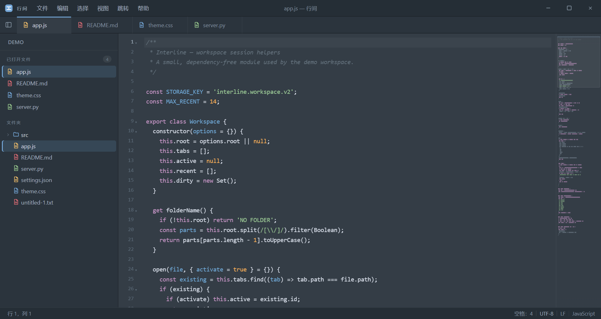

# 行间 · Interline

一款快速、克制的桌面文本 / 代码编辑器。界面参考 Sublime Text，默认简体中文，并保留 Notepad++ 用户熟悉的多标签、编码处理与文件管理能力。



## 功能特性

### 编辑

- 多标签页、未保存提示、关闭后可恢复
- 多光标与多选区：`Ctrl+D` 选中下一处匹配，`Alt+F3` 选中全部，`Ctrl+Alt+↑/↓` 添加光标
- 行操作：复制、删除、上下移动、合并、注释、缩进 / 反缩进
- 大小写转换、行排序、去除首尾空白
- JavaScript / TypeScript、Python、Java、C / C++、C#、Go、Rust、PHP、Ruby、Swift、Kotlin、HTML / CSS、Markdown、SQL、Shell 等 40+ 语言的语法高亮
- 自动换行、缩进设置、字号调整、小地图

### 编码

- 自动识别 UTF-8、UTF-16 LE / BE、GB18030、GBK、Big5、Shift-JIS 等常见编码
- 支持 BOM，支持 LF / CRLF 换行
- **ANSI**：按 Windows 当前系统代码页读取和保存（简体中文系统通常为 CP936 / GBK）
- 可在打开或保存时手动指定编码，支持“以指定编码重新打开”
- 自动拦截二进制文件，避免误开损坏内容

### 查找与导航

- 查找 / 替换，支持正则、大小写匹配与全词匹配
- 在文件夹中搜索，结果可跳转到对应行
- 快速打开文件、命令面板、跳转行
- 最近文件与会话恢复

### 工作区与界面

- 打开文件夹、文件树浏览，右键新建 / 重命名 / 移至回收站 / 在资源管理器中显示
- 拖放打开文件或文件夹
- 单实例运行：再次打开文件时复用当前窗口
- 四套主题：Mariana、Monokai、One Dark、Light
- 中文 / English 界面随时切换
- 无边框窗口、自定义标题栏、可折叠侧栏与可调宽度

## 快捷键

| 操作 | 快捷键 |
| --- | --- |
| 打开文件 | `Ctrl+O` |
| 打开文件夹 | `Ctrl+Shift+O` |
| 保存 | `Ctrl+S` |
| 另存为 | `Ctrl+Shift+S` |
| 查找 / 替换 | `Ctrl+F` / `Ctrl+H` |
| 在文件夹中搜索 | `Ctrl+Shift+F` |
| 快速打开文件 | `Ctrl+P` |
| 命令面板 | `Ctrl+Shift+P` |
| 跳转行 | `Ctrl+G` |
| 切换侧栏 | `Ctrl+B` |
| 关闭标签页 | `Ctrl+W` |
| 恢复关闭的标签页 | `Ctrl+Shift+T` |
| 下一个 / 上一个标签页 | `Ctrl+Tab` / `Ctrl+Shift+Tab` |
| 字号放大 / 缩小 / 重置 | `Ctrl+=` / `Ctrl+-` / `Ctrl+0` |
| 查找下一个 / 上一个 | `F3` / `Shift+F3` |

## 关于 ANSI 编码

在中文 Windows 上，“ANSI”通常对应 **CP936（GBK）**，但它本质上取决于系统的“非 Unicode 程序语言”设置。Interline 会读取 Windows 当前活动代码页，并在编码菜单中显示实际映射，例如 `ANSI · GBK · CP936`。

如果文件出现乱码，可使用状态栏编码菜单中的“以指定编码重新打开”，选择正确的编码后即可正常查看；如需转换编码，再通过“保存编码”另存即可。

## 开发

需要 Node.js 20+ 与 npm。

```bash
npm install
npm start        # 构建并启动应用
npm run dev      # 构建并以开发模式启动
npm run build    # 仅构建 dist/bundle.js 与 dist/bundle.css
npm run shot     # 构建、截图并退出
```

构建产物输出到 `dist/`，由 `scripts/build.js` 使用 esbuild 生成。

## 项目结构

```text
electron/        主进程与 preload
src/             渲染进程模块（编辑器、标签页、侧栏、查找、i18n 等）
styles/          全局样式与主题变量
index.html       应用界面结构
scripts/build.js esbuild 构建脚本
demo/            演示工作区
assets/          图标与预览图
```

## 技术栈

- Electron 45
- CodeMirror 5
- esbuild
- iconv-lite、jschardet

## 许可证

[MIT](LICENSE)
